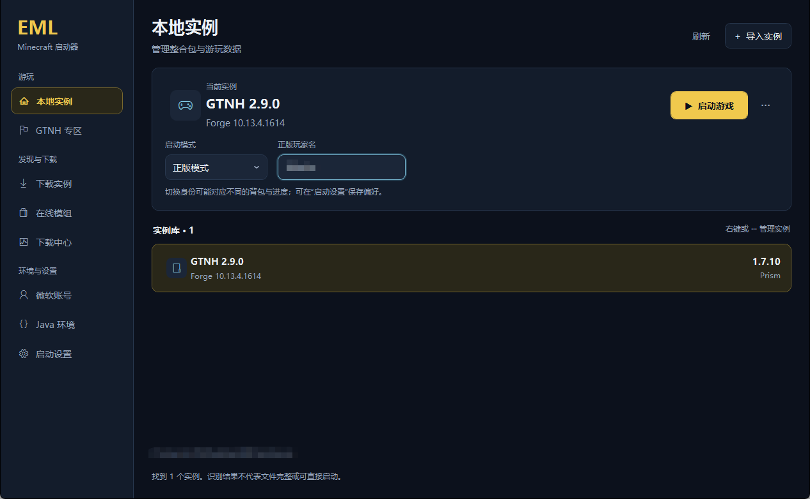
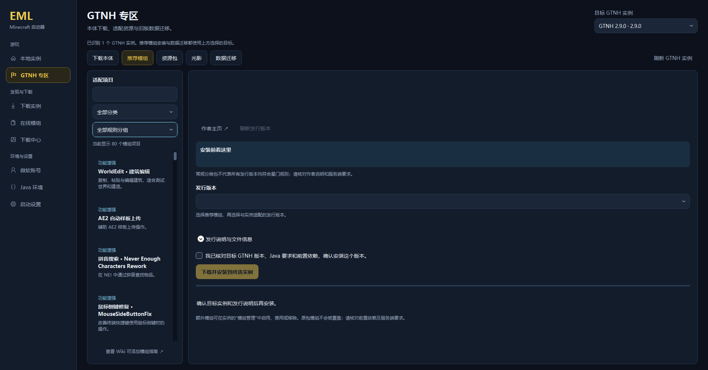
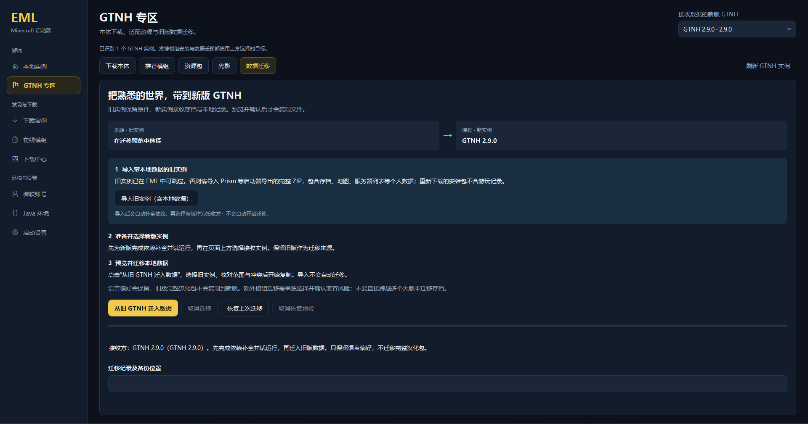

# EML Launcher

[简体中文](README.md) | English

EML is a Windows launcher built for **GT New Horizons (GTNH) players in China**.

A GTNH playthrough can last through several pack updates. EML brings pack installation, Java setup, mod management and player-data migration together, so moving to a newer instance doesn't mean sorting through your saves, maps and settings by hand. It also supports other common modpack formats, downloads from Modrinth and CurseForge, and vanilla Minecraft Java Edition.

**Current version: 1.0-RC1, a release candidate.** Compatibility testing is ongoing. See the [release guide](docs/release-rc1.md) for package details and testing instructions.

## Screenshots

Screenshots show the Chinese interface. Personal details have been redacted.

GTNH hub: recommended mods

GTNH player-data migration guide

## What you can do

### Install and play

- Download modpacks from Modrinth or CurseForge, or install vanilla Minecraft from Mojang's version catalog. Import Prism ZIPs, Modrinth `.mrpack` files, CurseForge ZIPs and supported game-directory ZIPs; dependency downloads start after import.
- Detect installed Java runtimes or download a suitable one from the Java page. If an instance has no compatible Java, EML asks before downloading and installing it. Existing Java installations and system environment variables are left alone.
- Sign in with Microsoft or choose an offline name. Save Java, memory and JVM settings per instance, and view game logs. Online mode uses the signed-in Minecraft profile and a valid session; authentication failure does not silently switch you to offline mode.

### GTNH hub

- Choose a specific Prism/MultiMC client pack from the integrated China-based mirror, then download, import and prepare a new instance.
- Browse categorized mods, resource packs and shaders with Chinese descriptions, source links and compatibility notes. Supported release files can be installed into a selected GTNH instance.
- Import an old instance with its player data, then preview and migrate selected data to a newer instance. Keep the old instance while checking the result.

### Mods and add-ons

- Search Modrinth and CurseForge by Minecraft version, loader and other filters. View icons, descriptions and releases, then choose an exact file to install.
- In online mod search, choose whether to include required dependencies and select optional dependencies individually. Review the installation plan before downloading.
- Add local mods, or explicitly take over untracked extra mods. Enable, disable, move to the recovery area or restore supported managed files. Mods declared by the imported pack remain protected; this is not an unrestricted editor for every file in `mods`.

### Downloads and instance care

- Manage file transfers in one download center: pause, resume, cancel, set queue priority, adjust concurrency and cap total bandwidth. Compatible downloads can reuse verified cache entries or resume partial transfers when the source supports it.
- Find instances in the launcher's `instances/` folder, inspect their details, rename or delete them, or export a ZIP backup. Right-click an instance or use the “···” beside the launch button for its management tools.
- Run quick or full integrity checks that account for file sources, accepted user changes and recorded mod enable/disable/removal choices. Normal launches check essential startup requirements without hashing the whole pack again. Export checks use the current import limits before publishing a backup.

## Moving to a newer GTNH version

Keep two instances: **the old one containing your player data**, and **a separate new version whose dependencies are complete and which starts successfully**. Close both games before migration.

If the old instance is still in another launcher, use “Import old instance (with local data)” in the GTNH hub. Its archive must actually contain your saves and maps; downloading the original pack again will not recover your play history.

Choose the new instance as the destination, select the old instance and review what will be copied:

- Worlds, NEI records, JourneyMap maps, ore-vein and Thaumcraft-node data, selected personal settings and server lists.
- A server-player preset for local client data, without copying a server world.
- Your language preference and individually selected extra mods. Extra mods require a separate compatibility warning and confirmation.

EML leaves the old instance's game files intact and backs up destination files before changing them. Conflicting worlds are kept in separate folders rather than merged. The last migration can be undone when its recovery conditions still hold; recovery refuses to overwrite files changed afterwards.

**This is client-data migration, not server upgrading.** It carries over language preferences, not an old Chinese translation pack. It cannot guarantee world compatibility across pack versions. Follow GTNH's update guidance and verify your saves when moving between major versions. See the [migration guide](docs/gtnh-player-data-migration.md) for supported files and recovery details.

## Getting started

1. Extract the Windows x64 package in full to a folder you can write to, then run `EML.App.exe`. Do not run it inside an archive viewer or copy only the EXE. The launcher includes its required .NET runtime; Visual Studio and the .NET SDK are not needed. Java is separate.
2. Download a pack from the GTNH hub or “Download instances,” or import a local archive. Wait for preparation to finish and resolve any files marked for manual handling.
3. Detect or download Java on the Java page. For online mode, sign in on the Microsoft account page first. In launch settings, choose the identity, Java, memory and JVM options for the instance. Online play requires the relevant game entitlement, service access and a network connection; offline mode does not replace that authentication.
4. Launch the game. If it fails, check the reported reason and runtime logs before changing files.

Before upgrading or uninstalling EML, stop the game and launcher tasks, close EML, and back up the data you need **outside the application folder**. That folder may contain worlds, maps and migration backups. An exported instance ZIP is not a replacement for a full launcher-folder backup. Follow the [upgrade guide](docs/release-rc1.md) or [uninstallation guide](docs/uninstall.md).

## Current status and limits

- RC1 is a test release, not a promise that every pack and PC works. Automated and package checks are recorded in the [verification notes](docs/release-rc1-verification.md); clean-machine and full end-to-end testing are not complete.
- Some platform files require manual handling. For eligible CurseForge mod files without a direct download, EML tries a Modrinth file with the same official SHA-1 and size, not a similarly named mod or a different version.
- The GTNH catalog is not a guarantee of compatibility or automatic installation. Some entries open an author page, and recommended-project dependencies are not installed automatically. Resource packs and shaders still need to be enabled in-game.
- GTNH mirror archives currently have no official-hash verification. See the [GTNH hub guide](docs/gtnh-hub.md) for the checks that are performed.
- Chinese names and summaries cover selected mods. Modpack descriptions retain Chinese text supplied through the platform API; English-only descriptions remain in English. EML does not automatically translate every project.
- Pack and loader support depends on available metadata and implemented installers. Completing a download or exporting a ZIP does not prove that the game will launch; shared dependencies outside an instance are not included in its ZIP export.

## Documentation

Feature guides are currently in Chinese:

- [GTNH hub](docs/gtnh-hub.md) · [Player-data migration](docs/gtnh-player-data-migration.md)
- [Instance downloads](docs/instance-downloads.md) · [Download center](docs/download-center.md)
- [Online mods](docs/online-mod-management.md) · [Local mod management](docs/local-mod-management.md)
- [Java downloads](docs/java-downloads.md) · [Launch settings](docs/launching.md) · [Microsoft sign-in](docs/microsoft-login.md)
- [File integrity](docs/gameplay-file-policy.md) · [Instance backups](docs/instance-backups.md)
- [RC1 release and upgrades](docs/release-rc1.md) · [Verification record](docs/release-rc1-verification.md)

## Contact, privacy and security

Maintainer: **K4ssia**. Contact **[477619464@qq.com](mailto:477619464@qq.com)** for questions, privacy requests or private vulnerability reports. For a bug report, include the EML and pack versions, Java version, reproduction steps and only the relevant, redacted error details. Do not send credential files, tokens, full private logs or instances, or post sensitive vulnerability details publicly.

Instances, settings and account credentials are stored locally. Sign-in, search, icons and downloads connect to third-party services. There is currently no maintainer-operated data collection server, donation service or separate feedback platform.

[Privacy](PRIVACY.md) · [Security reporting](SECURITY.md) · [Uninstallation and keeping player data](docs/uninstall.md). These documents include English summaries.

## License

EML is licensed under the **GNU General Public License, version 3 or any later version (`GPL-3.0-or-later`)**. See [LICENSE on master](https://github.com/Ph1lK4/EML/blob/master/LICENSE).

Minecraft, modpacks, mods, resource packs, Java and other third-party components retain their own licenses and terms.

## Code signing policy

The current `1.0-RC1` package is **unsigned**. SignPath Foundation support is planned, not approved or active. **K4ssia** is responsible for code review and signing approval; the [code signing policy](docs/code-signing.md) describes the remaining security setup and planned process.
